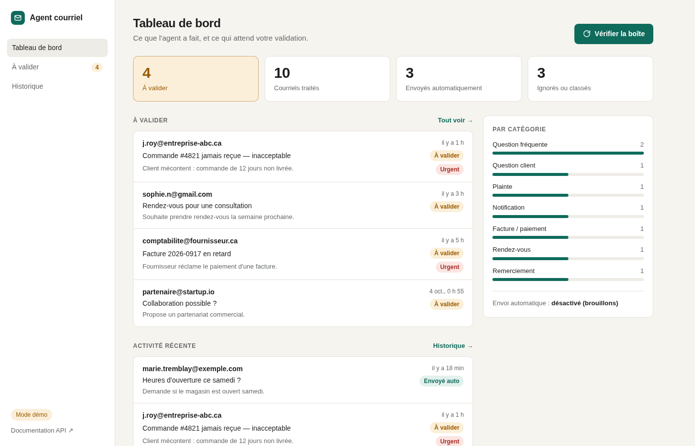
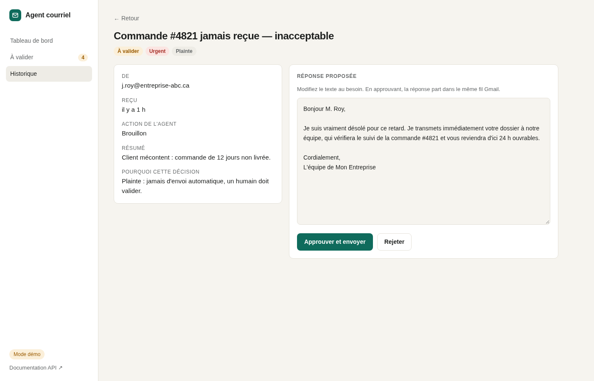
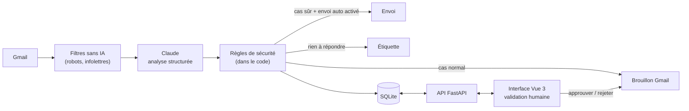
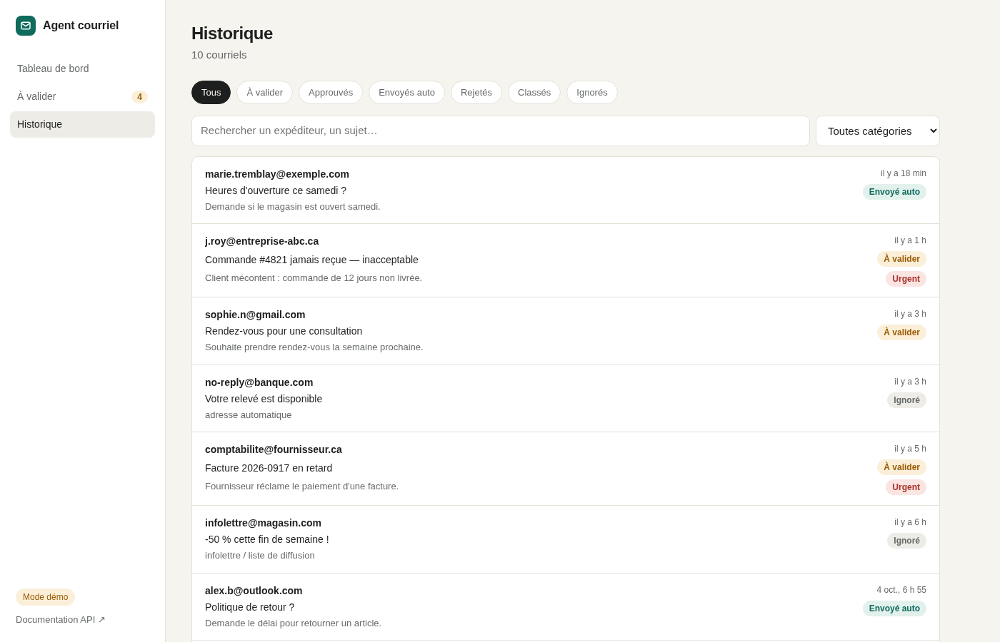

# Agent IA de réponse aux courriels

[](https://github.com/Sidi-Jdide/agent-courriel/actions/workflows/ci.yml)


-D97757)


Un agent qui surveille une boîte Gmail, comprend chaque courriel avec **Claude** (Anthropic), le classe et prépare une
réponse. L'IA propose, **un humain valide** : les réponses arrivent en brouillon dans une interface web où l'on peut
les corriger, les approuver ou les rejeter.



## Essayer en une commande

Le mode démo fonctionne sans compte Gmail ni clé API (données fictives) :

```bash
docker compose up --build demo
```

Puis ouvrir **http://localhost:8000** (interface) et **http://localhost:8000/docs** (API interactive Swagger).

<details>
<summary>Sans Docker</summary>

```bash
pip install -r requirements.txt
cd frontend && npm install && npm run build && cd ..
python -m api --demo
```
</details>

## Ce que fait l'agent

| | |
|---|---|
| **Trie sans IA d'abord** | no-reply, infolettres, réponses automatiques et domaines bloqués sont écartés gratuitement, avant tout appel à l'IA. |
| **Analyse avec Claude** | catégorie, priorité, résumé, réponse rédigée, niveau de confiance et justification, en sortie JSON garantie. |
| **Répond avec vos informations** | Claude s'appuie uniquement sur une base de connaissances ([`connaissances.md`](connaissances.md)) ; s'il ne sait pas, il transmet à l'équipe. |
| **Laisse la décision à un humain** | brouillon dans le bon fil Gmail ; l'utilisateur le modifie puis l'approuve (envoi) ou le rejette. |
| **Explique ses choix** | chaque décision est justifiée et visible dans l'interface. |



## Architecture



```
agent/               cœur métier, indépendant du web
  agent.py           orchestration + règles de sécurité
  cerveau.py         Claude : prompt système + outil d'analyse structurée
  gmail_client.py    API Gmail : lecture, brouillons, envoi, étiquettes
  memoire.py         SQLite (verrou multi-thread, migration automatique)
  config.py          réglages (.env)
  demo.py            données fictives
api/                 backend FastAPI
  app.py             routes REST, injection des dépendances, service du frontend
  schemas.py         contrats Pydantic (→ OpenAPI / Swagger)
frontend/            Vue 3 + TypeScript + Vite + Vue Router
  src/api.ts         client HTTP typé, gestion des erreurs
  src/views/         tableau de bord, historique, détail
  src/composables/   état partagé (tableau, notifications)
tests/               pytest : agent, sécurité, API
main.py              agent en ligne de commande (--simulation, --boucle, --journal)
```

## Choix techniques

**L'IA propose, le code décide.** Claude peut dire qu'une réponse est sûre, mais l'envoi automatique exige en plus,
côté code, une confiance ≥ 0,85, une catégorie autorisée et une priorité non haute. Les plaintes et les paiements ne
partent jamais seuls. Une règle de sécurité ne doit pas dépendre d'un modèle probabiliste.

**Sortie structurée par *tool use*.** Plutôt que d'analyser du texte libre, l'agent force Claude à appeler un outil
au schéma JSON strict (`tool_choice`). Les valeurs sont ensuite revalidées (catégorie inconnue → `autre`).

**Protection contre l'injection de prompt.** Le courriel est encadré par des balises et présenté comme une donnée. Une
tentative de détournement fait passer la réponse en validation humaine et est signalée dans la justification.

**Filtrer avant d'appeler l'IA.** Les courriels automatiques sont écartés par des règles simples : moins de coûts,
moins de latence, moins de bruit.

**Injection de dépendances.** L'API reçoit Gmail, la mémoire et l'agent via un objet `Services`. Le même code tourne
avec Gmail réel, en mode démo ou avec des faux objets dans les tests, sans aucun appel réseau.

**Erreurs explicites et cohérence.** `409` si le brouillon est déjà traité ou si un passage est en cours (verrou),
`502` si Gmail refuse : le statut n'est alors pas modifié, pour qu'une base locale ne contredise jamais la boîte réelle.
Un courriel en erreur n'arrête pas le passage.

**Un seul déploiement.** Build Docker multi-étapes (Node → Python) : FastAPI sert l'API et l'application Vue compilée,
avec un utilisateur non-root et les secrets exclus de l'image.

## API REST

| Méthode | Route | Rôle |
|---|---|---|
| GET | `/api/sante` | mode, envoi auto, modèle |
| GET | `/api/statistiques` | totaux, à valider, répartition par catégorie |
| GET | `/api/courriels?statut=&action=&categorie=&q=&page=&taille=` | liste filtrée et paginée |
| GET | `/api/courriels/{id}` | détail |
| POST | `/api/courriels/{id}/approuver` | envoie le brouillon (texte modifié optionnel) |
| POST | `/api/courriels/{id}/rejeter` | supprime le brouillon |
| POST | `/api/agent/cycle` | lance un passage de l'agent |

Codes d'erreur : `404` introuvable, `409` déjà traité ou passage en cours, `422` paramètre invalide, `502` erreur Gmail.

## Qualité

À chaque push, [GitHub Actions](.github/workflows/ci.yml) vérifie le backend (ruff, pytest), le frontend (types
TypeScript stricts, Vitest, build) puis construit l'image Docker.

```bash
pytest -q                          # 20 tests : agent, règles de sécurité, API
ruff check . && ruff format --check .
cd frontend && npm test            # 8 tests : logique d'affichage, composants
cd frontend && npm run build       # vérification TypeScript + build
```

## Brancher une vraie boîte Gmail

1. Clé Claude : https://console.anthropic.com → dans `.env` (copier `.env.example`).
2. Google Cloud Console : créer un projet, activer **Gmail API**, configurer l'écran de consentement (utilisateur
   test), créer un **ID client OAuth « Application de bureau »**, télécharger le JSON sous le nom `credentials.json`.
3. Première connexion (ouvre le navigateur, crée `token.json`) : `python main.py --simulation`
4. Lancer :
   ```bash
   python -m api                  # interface + API
   python main.py --boucle 300    # vérification toutes les 5 min (autre terminal)
   ```
   ou `docker compose up --build agent verificateur`.

Par défaut l'agent ne crée que des brouillons. L'envoi automatique s'active explicitement (`ENVOI_AUTO=true`).

## Développement

```bash
python -m api --demo              # terminal 1 : API sur :8000
cd frontend && npm run dev        # terminal 2 : Vite sur :5173 (rechargement à chaud, proxy vers l'API)
```



## Feuille de route

- [ ] Authentification de l'interface pour un déploiement en ligne
- [ ] Notifications Gmail en temps réel (Pub/Sub) au lieu d'une vérification périodique
- [ ] Historique complet du fil transmis à Claude pour les longues conversations
- [ ] Support Outlook (Microsoft Graph)
- [ ] PostgreSQL et file de tâches pour les gros volumes

## Auteur

**Sidi Jdide**, développeur full stack · Québec, Canada
[jdide-sidi.com](https://jdide-sidi.com/) · [LinkedIn](https://www.linkedin.com/in/sidi-jdide-68a9041aa)
